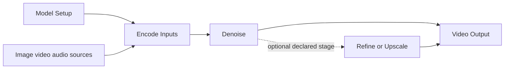

# Video stages workflows and templates

Prepared on 1 November 2026 for the approved video-stage design. This is an implementation plan, not an execution or release signoff. It covers shared video authoring and a bounded Linux campaign for LTX, Wan, MiniMax H3 and Pika H3 Flex. The estimates assume one source author and one Linux model worker.

The expected effort is **43–73 active engineering hours**, including focused tests and review. Reserve **52–88 hours with contingency**, plus model downloads and execution that cannot overlap useful coding. At eight focused hours per working day, allow roughly **7–11 working days**, with external access or hardware blockers able to extend that. This is not a promise that all four families will fit before resource admission is measured.

Use [tasks.json](tasks.json) for estimates, dependencies and status. Use [Logging and postmortem](logging.md) and [run-record.template.json](run-record.template.json) for private execution evidence. This backend directory is the canonical plan; do not maintain divergent Windows and Linux copies.

## Decisions carried forward from the conversation

1. Nodes represent understandable stages and work across compatible models. A Python function call is not automatically a useful visible node.
2. The approved starting shape is **Model Setup → Encode Inputs → Denoise → Video Output**. Four is not a limit. Add a meaningful stage when the selected workflow actually needs it.
3. Keep stage internals inspectable and separable. Preserve compatible values, connections and saved User Nodes when switching models or tasks.
4. Run large models on Linux. Windows handles source edits, lightweight checks, browser UX and playback; leave room for the user's other applications.
5. Keep source in the existing backend/client PRs, both number 7. Windows remains the sole authoring location; Linux receives exact published revisions and produces evidence, not an independent patch series.
6. Finish the bounded image work and recover at least 700 GB before video model work. That storage prerequisite passed; preserve its evidence rather than repeating it.
7. The Linux machine is physically in India, as already confirmed by the user. Do not ask its location again. Exact model terms/access remain model-specific, and earlier FLUX acknowledgements are not acknowledgements for new video models.

The conversation review included the original video request, the approval without a four-stage cap, the offload question, the 700 GB condition and the completed image handoff. No video model was downloaded or executed to write this plan.

## Starting point and evidence to reuse

| Item                             | Reviewed state                                                                                                                                                                                |
| -------------------------------- | --------------------------------------------------------------------------------------------------------------------------------------------------------------------------------------------- |
| Backend application source       | `da44556740b09a65ce0b7c59f79e2ed3f3067fcf`                                                                                                                                                    |
| Client source                    | `add24386c68eb103fbca8b9b43b6e22e84ce3399`; built application source `ef37863c4a5ab2c3736090a6f4fad81b849578d9`                                                                               |
| Source branch                    | `fix-ui-ux-issues` in both repositories; clean before plan authoring                                                                                                                          |
| Published changes                | [Backend PR 7](https://github.com/sdevil7th/MoDiff/pull/7), [Client PR 7](https://github.com/sdevil7th/MoDiff-client/pull/7)                                                                  |
| Storage                          | Fresh read at 07:20 UTC / 12:50 IST on 1 November: **766,492,295,168 bytes available**, about 766.49 GB / 713.85 GiB                                                                          |
| Linux memory                     | 130,153,119,744 physical bytes, about 121.2 GiB; Radeon 8060S, `gfx1151`, uses shared system memory                                                                                           |
| Runtime                          | Existing reviewed ROCm profile; application reports ready. Base source contract pins Diffusers 0.41.0; the deployed evaluation runtime is the separate pinned `7ecb1e1` build                 |
| Image closeout                   | 59 passing historical reports across 52 recipes reused; six specialty Linux stage executions and portrait revision completed; 14 completed cache roots retired; outputs and receipts retained |
| Outstanding general release work | Historical Gallery/current-lock discrepancies, broader catalog/hardware qualification and publication work remain separate. Do not claim they are closed by video tests                       |
| Current CI                       | The two image-closeout CI runs were still in progress at planning readback. V0 reads their actual conclusions; pending is not passing                                                         |

The initial connection to the old numeric SSH address timed out; the saved hostname subsequently worked. This is a resolved planning observation, not a current hard blocker. Fresh queue ownership and model-cache completeness still need admission checks before any model run. A planning request used the wrong HTTP method for queue status and received 405; no queue mutation or idle claim followed from that response.

Private originals remain in the image closeout handoff and the Linux validation archive. Keep private host paths, task IDs, raw logs, media and credentials out of source Git. Record their pointers in the private ledger described in logging.md.

## Current code and the actual gaps

`BE/` denotes this repository; `FE/` denotes the sibling MoDiff-client repository. These are explanatory prefixes, not new directories.

| Area                          | Existing implementation                                                                                                                                                                                       | Work required                                                                                                                                                                           |
| ----------------------------- | ------------------------------------------------------------------------------------------------------------------------------------------------------------------------------------------------------------- | --------------------------------------------------------------------------------------------------------------------------------------------------------------------------------------- |
| Generic video execution       | `BE/modules/DiffusersVideo/main.py`: `VideoPipelineAdapter`, `LoadPipeline`, `Generate`, `GenerateVideoAudio`, shot jobs and sequences                                                                        | Reuse its task contracts and legacy compatibility. A whole-pipeline Generate cannot become separate encoding/denoising merely by renaming it                                            |
| Editable Modular video        | `BE/modules/ModularDiffusers/workflow_blocks.py`, `loaders.py`, `operation_contracts.py`; `BE/modiff/modular_action_bindings.py` and `studio_execution_specs.py`                                              | Publish consistent stage roles and input/output semantics for admitted LTX/Wan/H3 paths; retain real upstream execution and the existing executor                                       |
| MiniMax H3                    | Three structurally admitted workflows, real before-encode/text/VAE/denoise/decode adapters; `tests/test_minimax_h3_structural_admission.py` explicitly keeps live/Auto/template/Gallery flags false           | Complete selected-artifact installation readiness, resource admission, actual execution, output acceptance and template admission. Structural support already exists; do not rebuild it |
| Pika H3 Flex                  | No current MoDiff registration or execution adapter                                                                                                                                                           | Add exact official Modular integration, selected mandatory adapter, schedule and artifact provenance using existing H3/shared mechanisms                                                |
| Shared stage presentation     | `FE/src/workflow/visualOperationGroups.ts`: `stageKind` rejects tasks containing `video`; setup/output eligibility permits only Image and Audio                                                               | Extend the existing presentation with declared video membership, ports, controls and outputs. Do not simply remove guards without reviewing ownership and media semantics               |
| Stage projection and controls | `FE/src/workflow/visualOperationGroupProjection.ts`, `src/components/VisualStageControls.tsx`, `StageNodeControls.tsx`                                                                                        | Reuse ordinary stage shells, inspect/separate actions, interface editing and shared history transactions                                                                                |
| Image stage precedent         | `BE/modules/DiffusersImage/stage_execution.py`; `FE/src/workflow/imagePipelineStageContracts.ts`; `BE/docs/image-pipeline-stages.md`                                                                          | Reuse ownership, conditioning/latent binding and invalidation principles. Video needs temporal and audio contracts, not image tensors under a new label                                 |
| Discovery and templates       | `BE/modiff/operation_starters.py`, `operation_contracts.py`, `studio_execution_specs.py`; `FE/src/studio/templateOperationWorkflow.ts`, `templateOperationSelections.ts`, `templates.ts`, `executionSpecs.ts` | Keep capability selection backend-owned. Author templates through current starters; do not add family-specific frontend execution branches                                              |
| Offload and cleanup           | `BE/modiff/diffusers_offload.py`, `diffusers_offload_modes.py`, `modules/ModularDiffusers/loaders.py`; disk-isolation and streaming-staging tests                                                             | Qualify H3 loading before full materialization, direct encode/decode hooks, adapter changes and owned scratch release on shared-memory ROCm                                             |
| Video delivery                | `BE/modules/Video/main.py`, `VideoConditioning/main.py`, `VideoColor/main.py`; encoded-metadata/export/batch tests                                                                                            | Reuse preview/export and processing. Prove frame counts, timestamps, audio synchronization and durable task attribution                                                                 |
| LTX-2.5                       | `BE/modiff/ltx25_execution_contract.py` binds an exact schedule and diffusion decoder with explicit NATTEN provisioning                                                                                       | Keep this distinct from LTX 0.9.8. Gated access and AMD decoder compatibility are unresolved; no silent replacement or runtime installation                                             |

Frontend documentation explicitly says video simplification was deferred in `FE/docs/developer-first-node-ux.md`. This is the feature gap; existing video code and historical video evidence must not be reported as absent.

## User experience and stage contracts

The dashed refinement path is optional, not a mandatory second pass. Model ownership also reaches every consuming stage through real typed connections; the diagram summarizes the visible sequence rather than every executable wire.

| Surface         | User-visible behavior                                                         | Implementation boundary                                                                                                                                    |
| --------------- | ----------------------------------------------------------------------------- | ---------------------------------------------------------------------------------------------------------------------------------------------------------- |
| Model Setup     | Model/task, required downloads, memory mode, precision and supported adapters | One owner; exact required component/adapter set. Required Pika adapter is part of the selected model recipe, not an optional style toggle                  |
| Encode Inputs   | Prompt; applicable first/last frames and ordered image/video/audio references | Real upstream text/media preparation. Sources remain connected outside the stage; encode cache invalidates only when its actual dependencies change        |
| Denoise         | Seed, legal size/frame duration, applicable sampling controls                 | No invented universal CFG/negative prompt/Steps. H3 keeps joint audio/video denoising together; Wan expert switching can remain inside the stage           |
| Video Output    | Decode, actual video player, synchronized audio when supported, save/export   | Real decoder and exporter remain inspectable. Preserve video-only output for models without audio; never synthesize a silent track and call it model audio |
| Optional stages | Refine, upscale, conditioning preparation, timeline/sequence operations       | Visible when they have a meaningful user choice and an admitted implementation. Independent processing stays outside generation                            |

For simple text/image-to-video, usually four main stages plus source nodes suffice. Reference preparation can make five; a real refinement pass can make five or six. A long sequence has a timeline/shot stage. The graph topology follows the pipeline; no test asserts a universal stage count.

Use the existing ordinary visual-stage presentation, not automatic enclosing Blocks. Inspecting does not change the graph. Separating or regrouping is one explicit Undo transaction. Existing workflows are not regrouped or rewritten during passive open/refresh.

Model switching preserves compatible prompts, media, seed, layout, user controls and external branches. Incompatible task ports or fixed schedules produce an explicit review with the affected values. An image wire means a specific declared media role, not permission to turn arbitrary text generation into reference editing.

A video conditioning/latent binding must include its owner and actual components, model/adapter revisions and order, workflow, runtime, dtype/offload, temporal geometry, FPS where consumed, media order, audio sample rates, applicable controls and generator state. Distinguish requested duration from legal generated frames and encoded playback duration. Do not reuse stale state across task/model/adapter changes.

## Model selection and bounded delivery matrix

| Family       | Initial target                                                          | Minimum functional workflows                       | Templates |
| ------------ | ----------------------------------------------------------------------- | -------------------------------------------------- | --------: |
| LTX          | Existing reviewed LTX-Video 0.9.8 13B distilled, exact catalog revision | Text, image, ordered references and video-to-video |         4 |
| Wan          | Existing reviewed Wan 2.2 TI2V 5B; verify cached completeness first     | Text and image-to-video                            |         2 |
| MiniMax H3   | Exact reviewed H3 base, one partition at a time                         | `t2va`, `fl2va`, `ref2va` with synchronized audio  |         3 |
| Pika H3 Flex | Exact Pika model/adapter snapshot with official Modular implementation  | `t2va`, `fl2va`, `ref2va` with synchronized audio  |         3 |

Deliver **12 versioned starter/template recipes**, initially as locally testable candidates. Reuse suitable existing LTX/Wan recipes rather than replacing their creative settings. At least one genuine accepted output per family is required for a four-family completion claim; each advertised task also needs its own accepted run. A blocked family remains an explicit incomplete row, not completion by substituting another model.

The LTX target is explicit because the user requested the family without requiring a particular version. LTX-2.5 is a separately estimated extension, not proof supplied by an older LTX run. Do not add the existing 30-minute/374-segment qualification job to this campaign. Wan VACE, all other video families, model training, universal Auto and every hardware platform are not silently added to these 12 recipes.

Pika entered official Diffusers main on 29 October after stable 0.42.1. Candidate upstream merge: `d0b9b1b5a540e5f9df2f8ec236347bf9c5aa7d1f`; it still needs dependency/source review before installation. Pika uses task-specific mandatory adapters and a fixed six-step schedule; it does not expose normal step count, CFG or negative-prompt inputs. [Official integration](https://github.com/huggingface/diffusers/pull/15150), [pipeline contract](https://huggingface.co/docs/diffusers/main/api/pipelines/pika_h3_flex).

## Work packages and estimates

All ranges below are active engineering time, including relevant focused tests. Downloads and unattended native execution are estimated separately. Dependencies may overlap within one authoring session; they do not authorize a second code-editing lane.

| ID    | Deliverable and approach                                                                                                                                                            | Active hours | Exit evidence                                                                                                                                             |
| ----- | ----------------------------------------------------------------------------------------------------------------------------------------------------------------------------------- | -----------: | --------------------------------------------------------------------------------------------------------------------------------------------------------- |
| V0    | Freeze current source/deployment, read existing CI results, inventory retained video evidence and caches, create preservation snapshot and private ledger                           |          1–2 | Exact pair/runtime/storage recorded; historical passes linked with their original scope; no active task outcome unknown                                   |
| V1    | Define shared video stage membership, conditioning/latent/audio contracts, controls and model-switch behavior. Map every selected route to real upstream blocks                     |          3–5 | Backend/FE fixture agreement; unsupported routes and migration behavior explicit; no fixed stage-count rule                                               |
| V2    | Review stable security/runtime changes and exact Pika upstream revision; constrain dependencies, lock hashes and compatible ROCm profile; keep historical catalog identity separate |          4–7 | No-download import/signature/security/loader tests; reviewed installation contract and rollback; no implicit installs                                     |
| V3    | Implement missing generic stage semantics and ordinary-path splitting where needed; reuse native Modular stages; fix ownership/cache/seed invalidation in existing execution path   |          5–8 | Failing-then-passing tests through normal graph dispatch; typed state rejects wrong owner/recipe/geometry; whole routes remain compatible                 |
| V4    | Extend shared FE stage groups, attachment/model-switch UI, controls, ports, inspect/separate, save/reopen/User Node/Undo behavior                                                   |          5–8 | Real browser gestures and persistence checks; unchanged image/audio fixtures; readable layouts; no passive normalization                                  |
| V5    | Close LTX/Wan route bindings and resource/default contracts against real upstream calls; use existing models/recipes where possible                                                 |          3–5 | Selected text/conditioned routes ready; model changes retain compatible graph values; correct temporal contracts and decode                               |
| V6    | Prove MiniMax/H3 loading and disk/group offload feasibility on this Linux host, then close MiniMax workflow/artifact/resource gaps                                                  |          5–9 | Bounded load/encode/denoise/decode proof and pressure traces; each selected partition only; clean repeat/release; explicit blocked decision if infeasible |
| V7    | Add Pika registration, artifact selection and required adapter lifecycle; reuse H3 infrastructure while retaining Pika's actual upstream sampler                                    |          4–7 | Adapter/scheduler/task/pin negatives; Pika-to-base transition has no adapter leakage; ordinary graph dispatch and native candidate output                 |
| V8    | Prepare exact model/download inventories and source media; calculate peak disk usage, verify access and complete only missing selected files                                        |          1–2 | Byte inventories, dedup proof where used, writable scratch/reserve checks and normal app readiness; no whole-repository downloads                         |
| V9    | Run bounded native acceptance and diagnose affected failures: the 12 recipes, selected repeat/seed/cancel/recovery/release cases and media review                                   |          4–7 | Genuine task-bound video/audio, consumed values, frame/FPS/audio metadata, motion review and lifecycle receipts                                           |
| V10   | Finalize 12 recipe descriptions, defaults, source assets, previews and template admission; prepare complete publication records                                                     |          3–5 | Template opens/runs/saves through normal UI; exact files and rights status identified; no placeholder treated as output                                   |
| V11   | Freeze one pair, run required final gates, mirror build, refresh dependent contracts in order, deploy and verify served bytes on both hosts                                         |          4–6 | Full gate results with old failures distinguished; exact source/assets; native acceptance tied to deployed pair; clean PR branches                        |
| V12   | Manual-test checklist, supported/blocked matrix, measured timing reconciliation, handoff and concise postmortem                                                                     |          1–2 | Reviewer can reproduce settings and locate evidence; remaining gaps have owner/next action rather than an ambiguous done flag                             |
| Total | V0–V12                                                                                                                                                                              |    **43–73** | Bounded video delivery, not full-app/all-hardware release                                                                                                 |

Execution order: V0 → V1 → V2 and V8 admission → early V6 feasibility → V3/V5 → V4 → V7 → V10 recipe freeze → V9 → V11 → V12. Download time can overlap source work after admission. V6's final acceptance depends on V3; its initial loading experiment does not wait for UI polish. V10 publication preparation starts before V9, but final admission requires V9 results.

First milestone: one LTX and one Wan template using the real shared stages, with saved editable graphs and playable outputs. Budget approximately **21–35 active hours** for V0–V5, plus relevant download/inference wait. The early H3 risk check can add time before this milestone; report its actual impact instead of hiding it. This first milestone is available for user testing while H3/Pika work continues.

Second milestone: MiniMax and Pika produce accepted short clips through the same interface. Third: all 12 bounded recipes, lifecycle evidence and final paired deployment. Public media upload is a separate final action after exact-file approval; it must not delay access to locally testable templates.

### Waiting time and estimate revision

- Provisional model-download allowance: **2–12 hours**, strongly dependent on cached bytes and connection speed. For illustration, 400 GB at a sustained 100 Mbps takes 8.9 hours before overhead; at 500 Mbps it takes 1.8 hours. Measure throughput and remaining bytes rather than trusting this example.
- Provisional native run/encode/decode allowance: **8–24 hours elapsed** for the bounded campaign, not a benchmark. H3 group-disk performance is unknown. Reforecast after the first complete legal clip in each family using measured load/encode/step/decode/export times.
- Start each long case with a stated task bound based on measured stages. The first H3 attempt has an initial 60-minute observation budget; extend deliberately only when progress and pressure support it, logging the revised bound before continuing. It is not an automatic retry timer.
- Include about 20% active-work contingency in the 52–88 hour scheduling range. If an unsupported load/kernel path needs a new implementation beyond the planned adapters, report a separate **8–20 hour** change estimate before expanding scope.
- LTX-2.5 access/decoder integration is an optional **6–12 active hours plus runs**, contingent on gated access and a reviewed ROCm-compatible decoder. A convolutional decoder must have a distinct declared recipe; do not claim it proves the old diffusion-decoder contract.

These waiting estimates can overlap active work; do not simply add every range to invent a calendar deadline. The first admission checkpoint must replace assumptions with measured throughput and model-stage timing.

## Resource feasibility and storage budget

**Offloading is a valid route to investigate, not a reason to reject H3 outright.** Diffusers supports group offload to disk. Ordinary CPU offload alone moves allocations within this host's shared RAM; it does not add capacity. Streamed prefetch can also increase host memory. The necessary proof covers loading and each stage, not just steady-state GPU allocation. [Official offload guidance](https://huggingface.co/docs/diffusers/main/en/optimization/memory).

The earlier metadata review found roughly 144 GB of full-precision files for one H3 workflow and roughly 147 GB including a Pika adapter. Both exceed this host's physical RAM as a simple all-resident load. First prune to the selected transformer partition, then evaluate existing component-wise/low-memory loading and immediate owned disk offload before loading the next component. Verify the text conditioner and both VAEs independently. Do not load everything and hope an offload call after loading prevents the peak.

Pika's publisher reports H100 measurements for sampling, with separate requirements for text encoding and VAEs; these are not ROCm qualification. Its shared-component implementation can reduce duplication, but model/adapter changes must retain MoDiff ownership and provenance. [Publisher hardware observations](https://raw.githubusercontent.com/Pika-Labs/Pika-H3-Flex/main/docs/hardware.md).

Use a provisional **20 GiB available-host reserve** during the initial experiment, reducing concurrency and prefetch first. Record unified RAM, swap growth, process RSS/commit where available, GPU allocated/reserved values, disk and stage progress. Adjust the reserve from evidence before qualification; do not quietly lower it to make a run start. Sustained pressure, uncontrolled swapping or loss of progress triggers a diagnosed stop through normal cancellation, followed by terminal-state verification. Never restart or delete scratch while a task's outcome is unknown.

After one unchanged resource failure, a retry must name a changed hypothesis and the corresponding supported resource change. Limit initial H3 admission to **two distinct placement experiments and 2–4 active diagnostic hours** within V6. Then report either a working route, a precisely diagnosed implementation task, or a hardware limitation. Continue independent LTX/Wan work instead of repeating the same allocation.

The 700 GB requirement was a **starting-space target**, not a promise to keep 700 GB unused while downloading video weights. At each admission require:

`free bytes >= missing selected model bytes + maximum simultaneous offload files + temporary download/conversion overhead + retained output allowance + operating reserve`.

Start with a 100 GB operating reserve and at most one heavyweight family/partition active. Planning envelope: up to 350 GB of selected cached weights, 150 GB of live offload copies, 60 GB of staging/output allowance and 100 GB reserve = 660 GB, below the observed 766.49 GB. These are caps for scheduling, not verified requirements. If the exact inventory exceeds them, sequence families or revise the budget before downloading.

MiniMax/Pika have common base components; reuse only after exact revision, per-file hash and loader-source equivalence are verified. Do not assume Hub caches deduplicate across repositories. If verified reuse is unavailable, avoid retaining duplicate full repositories simultaneously. Before any later cache retirement, retain accepted media, original inputs, recipes, model inventories and receipts; verify no live references. Existing deletion authorization is not permission to remove unrelated user projects or new unfinished model evidence.

## Acceptance and regression strategy

1. **No-weight checks first.** Exercise real pinned signatures, schema/registry visibility, workflow pruning, required adapters, fixed schedules, numeric edits, temporal bounds, mixed audio/video output and source approval. Normal graph dispatch must be covered; direct helper mocks alone are insufficient.
2. **Browser behavior.** Insert through the palette and templates; drag compatible sources; switch LTX/Wan where contracts permit; inspect/separate/regroup; edit internal values; save/reinsert User Nodes; Undo/Redo; refresh and restart. Verify exact graph/values and actual controls, not just enclosing rectangles. Run and Service/API export must select the same effective graph; add a focused video export/service contract check where affected.
3. **Bounded native matrix.** One fixed-input run for each of the 12 recipes. Use smallest publisher-supported quality dimensions/durations appropriate to its task, recorded before execution. Short engineering probes have separate recipe IDs and never replace final-template settings. Existing historical LTX/Wan results are baselines, not current staged-run proof.
4. **Repeat and change.** For one representative per family: unchanged Run checks actual cache reuse; explicit cache release plus a fresh run checks fresh computation and seeded behavior. Change prompt and seed separately to test encoder reuse/invalidation. For H3/Pika also prove adapter enable/reset and task-partition ownership. Do not assert cross-device or changed-kernel bit identity.
5. **Lifecycle.** Native Stop and successful subsequent run for both an ordinary video route and a joint H3 route; check queue/history/progress responsiveness, refresh recovery, exact output ownership, deletion of an owning loader, shared surviving owners and durable outputs after release.
6. **Media correctness.** Validate raw output and encoded file separately: real non-static motion, non-black/finite frames, spatial size, ordered frame count, rational FPS, timestamps, duration and audio channels/rate. Assess temporal coherence, requested action, input identity and audio alignment at beginning/middle/end. Do not manufacture motion through interpolation, pad audio or silently trim to pass. Retain poster/contact sheets plus original full clips; a still image is not video acceptance.
7. **Split equivalence.** When moving a route from whole-pipeline to stages, compare the exact upstream call and staged call with matching source, model, inputs and runtime on a bounded case. Preserve numerical differences and review perceptual/temporal quality. Existing Modular projections need execution/persistence proof, not an invented second implementation benchmark.
8. **Freeze and final gates.** Run focused tests during development, then full BE/FE gates once at a stable checkpoint. Repeat only after relevant fixes. Preserve original failed/hung harness logs and identify their cause instead of weakening assertions or raising every timeout.

Useful existing tests include `test_diffusers_video_registry.py`, `test_diffusers_video_extended_routes.py`, `test_minimax_h3_structural_admission.py`, `test_minimax_h3_artifact_review.py`, `test_modular_wan_route.py`, `test_reviewed_video_input_types.py`, `test_video_conditioning.py`, `test_video_export_batches.py`, `test_encoded_video_metadata.py`, `test_pipeline_disk_offload_isolation.py`, `test_streaming_offload_staging.py` and relevant loader tests. Extend FE `image-stage-groups.test.mjs` with shared cases and a focused video-stage suite; retain `wan-video-boundary.test.mjs`, `template-operation-workflows.test.mjs`, `block-v2-video-contract.spec.ts` and `visual-stage-groups.spec.ts` coverage.

Final BE commands follow CONTRIBUTING.md: pinned Ruff E9/F, package compatibility check, CPU preflight and complete maintained pytest suite. Run optional-runtime tests through `scripts/test_reviewed_optional_runtime.py` with bytecode disabled, not bare PYTHONPATH into a sealed runtime. Final FE: `npm ci`, `npm run check`, relevant `npm run check:ui`, and `npm run check:acceptance`. Record the latter's historical Gallery/catalog blockers as failures with their baseline comparison; no selective video pass is a full-app acceptance pass.

Build FE normally, mirror generated dist into BE web while preserving web/user, and regenerate dependent inventories in order: upstream coverage → template candidates → authoring specs → Comfy contract/evidence resolution. Compare semantic changes. Verify disk/served bytes and process-start source on each deployment, with fresh idle ownership and preservation snapshots.

## Blockers and decisions

| Risk                                | Action                                                                                                                                         | What it blocks                                                               |
| ----------------------------------- | ---------------------------------------------------------------------------------------------------------------------------------------------- | ---------------------------------------------------------------------------- |
| Pika is newer than installed source | Review and lock exact official code/package/dependencies; inspect 0.42.1 component-resolution security changes and compatibility               | Pika runtime and downloads relying on its new contract; not shared UI design |
| H3 loading peak/shared memory       | Early V6 staged-loading/group-disk admission and bounded diagnosis                                                                             | Honest four-family execution completion                                      |
| ROCm hooks or kernels incompatible  | Use only supported upstream paths; distinguish package/code fault from resource pressure; quantify additional work                             | Affected route, not all video work                                           |
| Model terms/gated access            | Review exact pinned terms and normal Hub access. Ask only for an actually missing acknowledgement/access action; preserve prior country answer | Affected model download/execution                                            |
| LTX-2.5 NATTEN/access               | Separate optional extension and explicit decoder recipe                                                                                        | LTX-2.5, not older reviewed LTX family coverage                              |
| Disk duplication/download time      | Hash-bound component selections, sequential partitions and actual disk checks                                                                  | Next download/load, not offline development                                  |
| Template quality fails              | Retain failed recipe/output; diagnose one variable; version creative changes and seek direction for material brief changes                     | That recipe's visual/publication acceptance                                  |
| Existing Gallery release issues     | Preserve baseline, prevent new regressions, report separate full-release hold                                                                  | Global release declaration, not access to local video candidates             |
| Human output approval               | Present exact local clips and final publication package, then obtain approval for those bytes and any needed credential use                    | Public Gallery upload only                                                   |

## Completion and communication

Before each work session, name the task ID, concrete change, affected files and intended proof. Report after a meaningful fix/run/checkpoint and keep active-turn updates concise. At each milestone show what is actually testable, the exact deployed pair, completed/failed/blocked rows, measured versus estimated hours and the next task. Do not describe time spent waiting as implementation progress.

Completion requires the shared stage behavior, all advertised bounded task rows, real media/lifecycle evidence, final deployed source pair and a manual checklist. Public Gallery approval is tracked separately. Missing hardware or model access is reported as a blocker, not an implementation pass. Preserve the existing image application and proof throughout; do not redownload retired image families for unrelated checks.

Only source, sanitized plans/fixtures and generated source contracts belong in the two existing PRs. Keep raw evidence private and immutable. The user receives an intermediate LTX/Wan build first, then the full bounded candidate for **2–3 hours of manual testing** after the final handoff.
